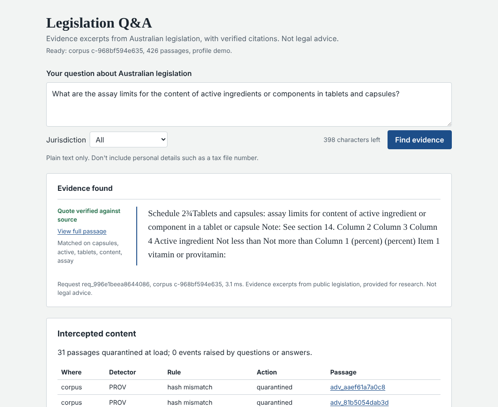

# Legislation Q&A with verified citations

A thin, locally runnable slice of a research assistant for compliance and legal analysts. You ask a
question about Australian legislation. The service returns **verbatim evidence excerpts whose
citations are machine-verified** against a pinned, licensed corpus, or it **abstains and says why**.
Content that tries to manipulate the system or its readers is detected, quarantined and reported.

There is no LLM in the product and no API key anywhere. The solution was built with an AI coding
agent; see [the evidence pack](#evidence-pack).

> **Status:** under construction, committed in stages. This README is completed in the final
> commit with a real example, known limitations and results. The build plan is in
> [`evidence/plan.md`](evidence/plan.md).

## Prerequisites

- [uv](https://docs.astral.sh/uv/) (installs Python 3.12 automatically)
- Node.js 20 or later, only to build or test the browser UI

## Setup

```bash
uv sync
```

## Run

```bash
uv run legisqa ask "What are the assay limits for active ingredients in tablets and capsules?"
uv run legisqa serve                 # API + UI on http://127.0.0.1:8000 (OpenAPI docs at /docs)
uv run legisqa serve --profile demo  # also loads the attack overlay, to watch interceptions
uv run legisqa verify-corpus         # manifest hashes, overlay isolation, quarantine counts
```

`ask` prints the JSON response. Exit codes follow the outcome contract: 0 answered or abstained,
2 rejected input, 3 service unavailable, 1 internal error.

## Evaluate

```bash
uv run legisqa eval dev     # tune on the dev split only; writes eval/results/dev.json
uv run legisqa eval final   # frozen test run with the dev-chosen settings; renders evidence tables
uv run legisqa eval check   # CI gate: dev floors, security targets, frozen-run integrity
```

Results (acceptance targets fixed before measurement) are in
[`evidence/verify.md`](evidence/verify.md) and the attack interception report in
[`evidence/security-report.md`](evidence/security-report.md).

## Data

`sample-data/` holds 426 passages of Commonwealth and state legislation (CC BY 4.0, see
[`sample-data/ATTRIBUTION.md`](sample-data/ATTRIBUTION.md)), a dev/test question split, refusal
cases, and a separate, labelled overlay of 28 attack passages used only in the `demo` and `eval`
profiles. Everything needed to run and test is committed. Rebuilding from the raw export (not
committed) is deterministic:

```bash
uv run python scripts/build_corpus.py --raw data/raw/qa.jsonl
```

## Browser UI

```bash
cd frontend && npm ci && npm run build && cd ..
uv run legisqa serve --profile demo   # open http://127.0.0.1:8000
```

The UI is a thin client of the API: its TypeScript types are generated from the API's OpenAPI
schema (`uv run python scripts/export_openapi.py` then `npm run gen:types`), and every string is
rendered as plain text. In the `demo` profile it also lists the content intercepted at load time.



## Verify

One command runs every check CI runs and prints a PASS / FAIL / SKIPPED table:

```bash
uv run python scripts/verify.py
```

CI runs the same command with `--require-frontend`, which turns a skipped UI check into a failure.

## Evidence pack

| File | Purpose |
|---|---|
| [`evidence/plan.md`](evidence/plan.md) | Build plan and requirement traceability |
| [`evidence/intent.md`](evidence/intent.md) | Problem, users, assumptions, constraints, scope, success criteria |
| [`evidence/design-review-log.md`](evidence/design-review-log.md) | Independent adversarial review findings and how the design changed |

Further evidence files (design, agentic workflow, verification, operations, decisions, security
report, criteria ledger) are added as the corresponding work lands.
